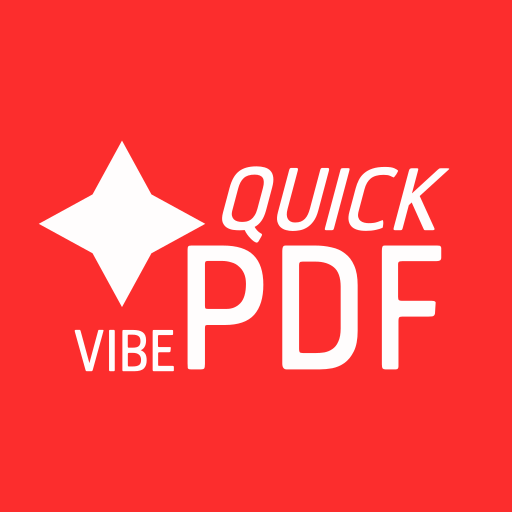
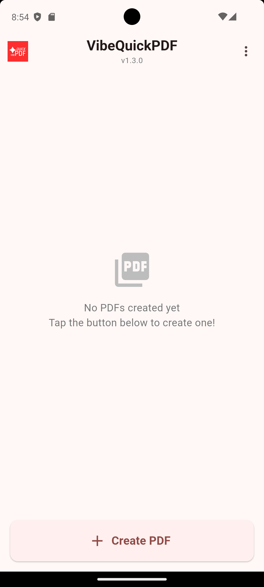
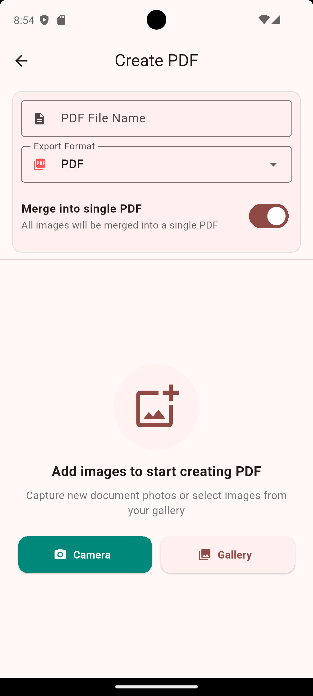
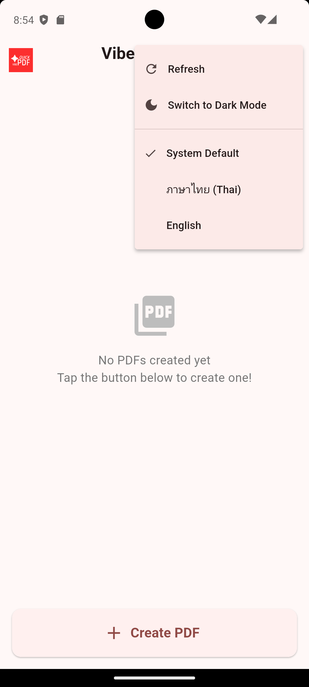
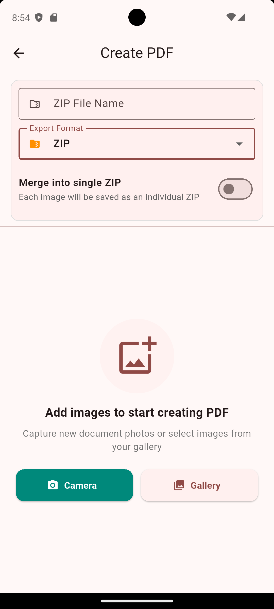

# VibeQuickPDF

<p align="left">
  
</p>


> [ภาษาไทย](README.md) | **English**

> **Project Status (Archived / Finished):** This project is considered complete at `v1.3.2` and is archived in a read-only state. No further updates or new features are planned. Feel free to browse the code, use it, or fork it under the MIT License.

A lightweight, fast Flutter app for converting images into PDF documents or ZIP archives, built for quick everyday document workflows and seamless OS share-sheet integration.

---

## Table of Contents

- [Motivation](#motivation)
- [Built with Vibe Coding](#built-with-vibe-coding)
- [Screenshots](#screenshots)
- [Features](#features)
- [Documentation](#documentation)
- [Requirements](#requirements)
- [Quick Start](#quick-start)
- [Project Structure](#project-structure)
- [License](#license)

---

## Motivation

My family frequently needed a fast, no-nonsense tool to turn photos into PDF files. I originally built a working app by hand without AI, and later decided to try "Vibe Coding" a personal utility app—primarily for real family use, and secondarily as a portfolio piece and open-source reference.

All planned features are now complete and working reliably, so the repository is archived at `v1.3.2`.

## Built with Vibe Coding

| Version | AI Model Used |
| :---: | :---: |
| v1.0.0 – v1.2.2 | Gemini 3.1 Pro |
| v1.3.0 – v1.3.2 | Gemini 3.8 Flash |

## Screenshots

| Home Screen | Create PDF / ZIP Screen |
| :---: | :---: |
|  |  |
|  |  |

## Features

- **Fast PDF & ZIP Conversion**: Convert sets of images into edge-to-edge PDF pages (matched to each image's exact dimensions) or package them into sequentially numbered `.zip` archives.
- **Quick PDF & Share**: When sharing images or archives from another app into VibeQuickPDF, convert and open the system share sheet in one tap without entering the editor.
- **Flexible Export Modes**: Merge all selected images into a single PDF/ZIP, or split them into one output file per image.
- **Public Documents Storage (`Documents/VibeQuickPDF/`)**: On Android, saved PDFs and ZIPs are written to the user-accessible `Documents/VibeQuickPDF/` folder (via `MediaStore` on Android 10+ and legacy external storage on Android ≤9) so files are easy to locate in any file manager.
- **Private File Registry & PDF Import**: The Home list is backed by a private JSON registry (`vibe_pdf_registry.json`) rather than folder scanning. On Android, users can register existing PDFs via **Import PDF From File** (Storage Access Framework) with multi-layered deduplication (exact URI, MediaStore ID, canonical/relative path, and SHA-256 content hash). Deleting an imported entry lets you either remove it from the list only or delete the underlying file.
- **Temporary PDF Preview**: Generate and open a temporary preview PDF before exporting; the temporary file is automatically cleaned up when the preview sheet closes or the screen is disposed.
- **Incoming Share & Archive Extraction**: Receive single or multiple images or archives (`.zip`, `.tar`, `.tar.gz`, `.tgz`, `.gz`) from other apps. Archives are automatically filtered for image files (ignoring macOS metadata/dotfiles), sorted alphabetically, and offered as *Append*, *Create New List*, or *Quick PDF & Share*.
- **Easy Page Management**: Capture with the camera or pick multiple photos from the gallery; reorder pages by long-press drag-and-drop or via a tap-to-reorder modal (First, Previous, Next, Last); delete individual pages or clear all.
- **Share Verification & Retry**: Detects incomplete share actions and prompts the user to retry.
- **Dark Mode & Bilingual UI**: Runtime switching between Light/Dark/System themes and Thai/English/System languages.

## Documentation

Detailed guides and technical references are available in [`docs/`](docs/):

- **[User Guide](docs/USER_GUIDE.md)** — Walkthrough of all features and workflows
- **[Architecture](docs/ARCHITECTURE.md)** — System design, data flows, private registry, and export pipelines
- **[Android Storage & Native Bridge](docs/ANDROID_STORAGE.md)** — `MethodChannel` contract, MediaStore, SAF, deduplication, and Intent filters
- **[Development & Build Guide](docs/DEVELOPMENT.md)** — Toolchain versions, building APKs, running tests, and known limitations
- **[Changelog](CHANGELOG.md)** — Release history from `v1.0.0` to `v1.3.2`

## Requirements

- **Flutter SDK**: `3.47.9` (stable channel) / **Dart SDK**: `^3.11.4`
- **Android**: JDK 17, Android Gradle Plugin `9.1.0`, Gradle `9.3.1`, Kotlin `2.4.0`
- **Primary Platform**: Android (full feature set including MediaStore storage and SAF PDF import). Other Flutter targets use a fallback app-documents directory.

## Quick Start

Clone the repository and install dependencies:

```bash
git clone https://github.com/JittiponPannak/VibeQuickPDF.git
cd VibeQuickPDF
flutter pub get
```

Run the app on a connected device or emulator:

```bash
flutter run
```

Build split release APKs (or run `build.bat` on Windows):

```bash
flutter build apk --split-per-abi
```

Run the test suite:

```bash
flutter test
```

## Project Structure

```text
VibeQuickPDF/
├── lib/
│   ├── main.dart                         # App entry point, Light/Dark themes, and localization setup
│   ├── l10n/
│   │   └── app_localizations.dart        # Thai & English localization strings and delegate
│   ├── models/
│   │   └── pdf_file.dart                 # PdfFile metadata model (name, path, date, size, isImported)
│   ├── screens/
│   │   ├── home_screen.dart              # Registry-backed file list, PDF import, theme/language menu
│   │   └── conversion_screen.dart        # Image picker, reordering grid, preview, PDF/ZIP export
│   ├── services/
│   │   ├── file_service.dart             # Registry persistence, Android MethodChannel bridge, share/open/delete
│   │   ├── pdf_service.dart              # Edge-to-edge PDF generation from image files
│   │   └── archive_service.dart          # Archive extraction (images) and ZIP creation
│   └── widgets/
│       ├── shared_media_dialog.dart      # Bottom sheet for handling incoming shared files
│       └── theme_toggle_button.dart      # Animated theme toggle widget
├── android/app/src/main/kotlin/com/jittiponpannak/quick_vibe_pdf/
│   └── MainActivity.kt                   # Native Android channel for MediaStore & SAF operations
├── test/                                 # Unit and widget tests
├── docs/                                 # User, architecture, Android storage, and developer docs
├── assets/                               # App icons and README screenshots
└── build.bat                             # Windows helper script to build split APKs
```

## License

This project is licensed under the [MIT License](LICENSE) — © 2026 Jittipon Pannak.
