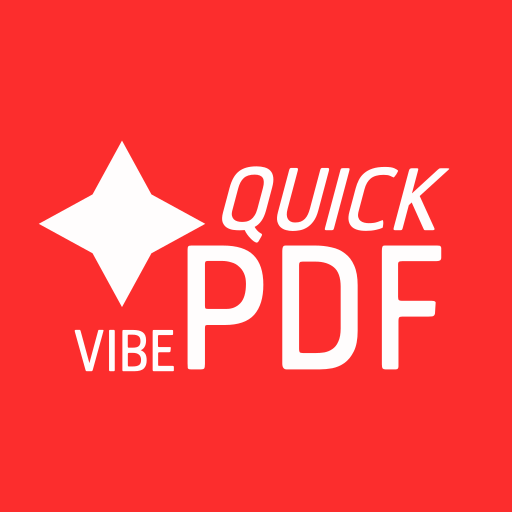
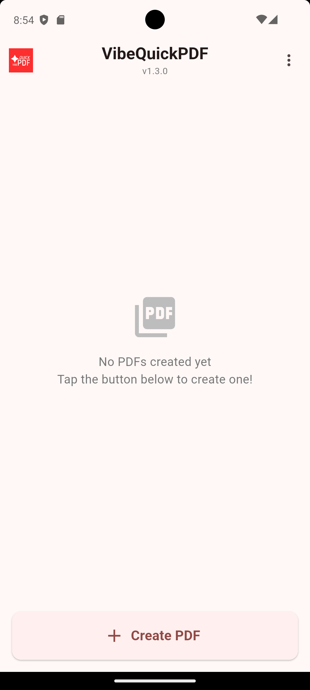
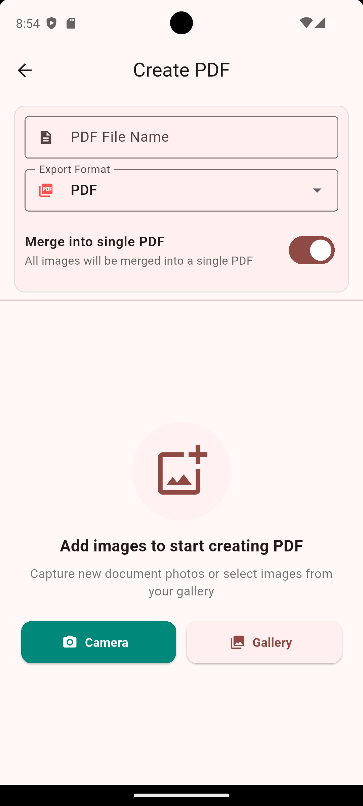
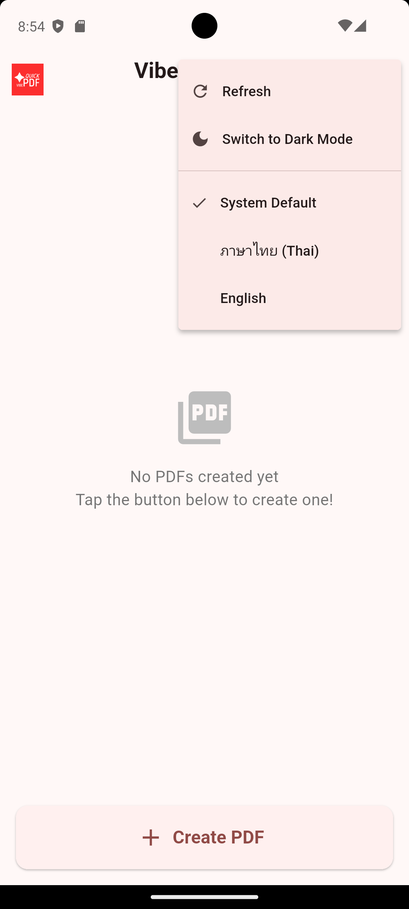
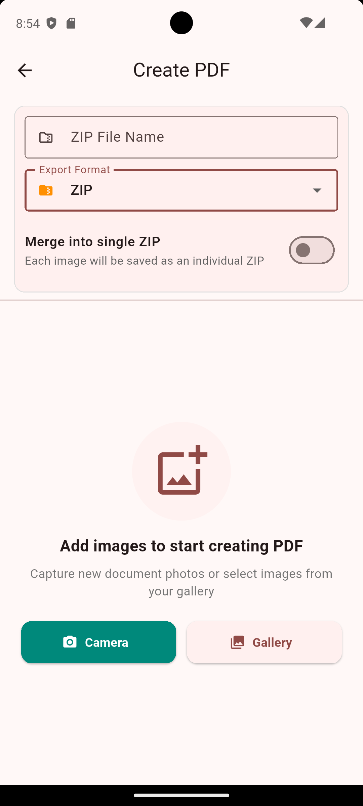

# VibeQuickPDF

<p align="left">
  
</p>


> **ภาษาไทย** | [English](README.en.md)

> **สถานะโปรเจกต์ (Archived / Finished):** โปรเจกต์นี้ถือว่าพัฒนาเสร็จสมบูรณ์ตามเป้าหมายแล้ว (เวอร์ชันสุดท้าย `v1.3.2`) และถูกจัดเก็บในสถานะ Archive จะไม่มีการเพิ่มฟีเจอร์ใหม่หรืออัปเดตเพิ่มเติมในขณะนี้ คุณสามารถดูโค้ด นำไปใช้งานต่อ หรือ Fork ไปพัฒนาต่อได้อย่างอิสระภายใต้สัญญาอนุญาต MIT

แอป Flutter ขนาดเล็กและรวดเร็วสำหรับแปลงรูปภาพเป็นไฟล์ PDF หรือบีบอัดเป็นไฟล์ ZIP เน้นการใช้งานที่เรียบง่าย รวดเร็ว และรองรับการรับไฟล์แชร์จากแอปอื่นโดยตรง

---

## สารบัญ

- [เหตุจูงใจในการพัฒนา](#เหตุจูงใจในการพัฒนา)
- [สร้างด้วยการ Vibe Code](#สร้างด้วยการ-vibe-code)
- [รูปภาพตัวอย่าง](#รูปภาพตัวอย่าง)
- [คุณสมบัติหลัก](#คุณสมบัติหลัก)
- [เอกสารประกอบ (Documentation)](#เอกสารประกอบ-documentation)
- [ความต้องการระบบ](#ความต้องการระบบ)
- [การติดตั้งและรันโปรเจกต์](#การติดตั้งและรันโปรเจกต์)
- [โครงสร้างโปรเจกต์](#โครงสร้างโปรเจกต์)
- [สัญญาอนุญาต (License)](#สัญญาอนุญาต-license)

---

## เหตุจูงใจในการพัฒนา

คนในครอบครัวมีความต้องการในการทำไฟล์ PDF อยู่บ่อยครั้ง ตอนแรกผมได้เขียนแอปขึ้นมาโดยไม่ใช้ AI (จนถึงตอนนี้แอปตัวนั้นก็ยังถือว่าใช้งานได้) แต่ด้วยความที่ผมอยากลองมีประสบการณ์ Vibe-Coding แอปพลิเคชันเพื่อนำมาใช้งานส่วนตัวเป็นหลัก และใช้เป็นผลงานประกอบเรซูเม่รวมถึงแบ่งปัน Source Code เป็นรอง จึงได้ออกมาเป็นโปรเจกต์นี้ครับ

ปัจจุบันฟีเจอร์ที่ตั้งใจไว้พัฒนาครบถ้วนและใช้งานได้จริงตามเป้าหมายแล้ว จึงขอปิดจบและเก็บโปรเจกต์นี้ไว้เป็นเวอร์ชันสมบูรณ์ที่ `v1.3.2`

## สร้างด้วยการ Vibe Code

| เวอร์ชัน | โมเดล AI ที่ใช้ |
| :---: | :---: |
| เวอร์ชัน 1.0.0 – 1.2.2 | Gemini 3.1 Pro |
| เวอร์ชัน 1.3.0 – 1.3.2 | Gemini 3.8 Flash |

## รูปภาพตัวอย่าง

| หน้าหลัก | หน้าสร้างไฟล์ PDF / ZIP |
| :---: | :---: |
|  |  |
|  |  |

## คุณสมบัติหลัก

- **แปลงรูปภาพเป็น PDF และ ZIP ได้อย่างรวดเร็ว**: แปลงชุดรูปภาพเป็นไฟล์ PDF (ปรับขนาดแต่ละหน้าพอดีกับขนาดภาพแบบไร้ขอบ) หรือรวมรูปภาพเป็นไฟล์ `.zip` พร้อมรันลำดับชื่อไฟล์อัตโนมัติ
- **สร้างและแชร์ทันที (Quick PDF & Share)**: เมื่อรับรูปภาพหรือไฟล์ Archive ที่แชร์มาจากแอปอื่น สามารถเลือกแปลงเป็น PDF และเปิดหน้าต่างแชร์ได้ทันทีในคลิกเดียวโดยไม่ต้องเข้าหน้าแก้ไข
- **ตัวเลือกการส่งออกที่ยืดหยุ่น**: เลือกรวมรูปภาพทั้งหมดเป็นไฟล์เดียว (Merge) หรือแยกสร้างทีละไฟล์ตามจำนวนภาพ (Split) ได้ทั้งรูปแบบ PDF และ ZIP
- **บันทึกลง `Documents/VibeQuickPDF/`**: บน Android ไฟล์ที่บันทึกจะถูกจัดเก็บไว้ในโฟลเดอร์สาธารณะ `Documents/VibeQuickPDF/` (ผ่าน MediaStore บน Android 10+ และ External Storage บน Android 9 ลงไป) เพื่อให้เปิดดูจากตัวจัดการไฟล์ภายนอกได้สะดวก
- **ระบบ Registry ส่วนตัว & นำเข้า PDF จากไฟล์**: หน้าหลักแสดงรายการไฟล์จาก Registry ส่วนตัว (`vibe_pdf_registry.json`) พร้อมเมนู **นำเข้า PDF จากไฟล์ (Import PDF From File)** บน Android ผ่าน Storage Access Framework (SAF) มีระบบตรวจสอบไฟล์ซ้ำอัตโนมัติ (ตรวจสอบทั้ง URI, MediaStore ID, พาธไฟล์ และ SHA-256) และเลือกได้ว่าเมื่อลบไฟล์ที่นำเข้าจะนำออกจากรายการเท่านั้นหรือลบไฟล์ออกจากเครื่องด้วย
- **พรีวิว PDF ก่อนส่งออก**: สร้างไฟล์ PDF ชั่วคราวเพื่อเปิดดูตัวอย่างได้ทันที และลบไฟล์ตัวอย่างทิ้งอัตโนมัติเมื่อปิดหน้าต่างพรีวิวหรือออกจากหน้า
- **รองรับการรับไฟล์แชร์จากแอปอื่น**: รับได้ทั้งรูปภาพเดี่ยว หลายรูป หรือไฟล์ Archive (`.zip`, `.tar`, `.tar.gz`, `.tgz`, `.gz`) พร้อมแตกเฉพาะไฟล์รูปภาพออกมาโดยอัตโนมัติ และให้เลือกได้ว่าจะต่อท้ายรายการเดิม สร้างรายการใหม่ หรือ Quick PDF & Share
- **จัดการและจัดเรียงหน้าได้ง่าย**: เพิ่มภาพจากกล้องหรือคลังภาพ กดค้างแล้วลากเพื่อจัดลำดับหน้า แตะที่รูปเพื่อเปิดเมนูปรับตำแหน่ง (หน้าแรก / ก่อนหน้า / ถัดไป / หน้าสุดท้าย) ลบภาพรายหน้า หรือล้างรายการทั้งหมด
- **ตรวจสอบสถานะการแชร์**: แจ้งเตือนพร้อมปุ่มลองใหม่หากการแชร์ไม่สมบูรณ์
- **รองรับ Dark Mode & สลับภาษา**: มีธีมสว่าง/มืด/ตามระบบ และสลับภาษาไทย/อังกฤษ/ตามระบบได้ทันทีภายในแอป

## เอกสารประกอบ (Documentation)

สำหรับรายละเอียดเชิงลึกทั้งการใช้งาน สถาปัตยกรรม และการพัฒนาต่อ สามารถอ่านได้จากเอกสารต่อไปนี้:

- **[คู่มือการใช้งาน (User Guide)](docs/USER_GUIDE.md)** — อธิบายทุกฟีเจอร์และขั้นตอนการใช้งานอย่างละเอียด
- **[สถาปัตยกรรมระบบ (Architecture)](docs/ARCHITECTURE.md)** — โครงสร้างโค้ด, Data Flow, Private Registry และ Pipeline การสร้างไฟล์
- **[ระบบจัดเก็บไฟล์บน Android (Android Storage & Native Bridge)](docs/ANDROID_STORAGE.md)** — รายละเอียด `MethodChannel`, MediaStore, SAF, Intent Filters และอัลกอริทึมตรวจสอบไฟล์ซ้ำ
- **[คู่มือสำหรับนักพัฒนาและการ Build (Development & Build Guide)](docs/DEVELOPMENT.md)** — สภาพแวดล้อมการพัฒนา, การ Build APK, การรันชุดทดสอบ และข้อจำกัดที่ทราบ
- **[ประวัติการเปลี่ยนแปลง (Changelog)](CHANGELOG.md)** — สรุปการเปลี่ยนแปลงตั้งแต่ `v1.0.0` ถึง `v1.3.2`

## ความต้องการระบบ

- **Flutter SDK**: `3.47.9` (stable channel) / **Dart SDK**: `^3.11.4`
- **Android**: JDK 17, Android Gradle Plugin `9.1.0`, Gradle `9.3.1`, Kotlin `2.4.0`
- **แพลตฟอร์มหลัก**: Android (ฟีเจอร์ครบถ้วนรวมถึง MediaStore และ SAF PDF Import) และรองรับการรันบนแพลตฟอร์ม Flutter อื่นๆ ด้วยโหมดจัดเก็บไฟล์สำรอง

## การติดตั้งและรันโปรเจกต์

โคลนรีโพซิทอรีและติดตั้ง dependencies:

```bash
git clone https://github.com/JittiponPannak/VibeQuickPDF.git
cd VibeQuickPDF
flutter pub get
```

รันแอปบนอุปกรณ์หรือ Emulator:

```bash
flutter run
```

สร้างไฟล์ APK แยกตาม ABI (หรือดับเบิลคลิก `build.bat` บน Windows):

```bash
flutter build apk --split-per-abi
```

รันชุดทดสอบ:

```bash
flutter test
```

## โครงสร้างโปรเจกต์

```text
VibeQuickPDF/
├── lib/
│   ├── main.dart                         # จุดเริ่มต้นแอป, Theme (Light/Dark) และ Localizations
│   ├── l10n/
│   │   └── app_localizations.dart        # ระบบข้อความสองภาษา (ไทย / อังกฤษ)
│   ├── models/
│   │   └── pdf_file.dart                 # โมเดลข้อมูลเมตาและสถานะการนำเข้าของไฟล์
│   ├── screens/
│   │   ├── home_screen.dart              # หน้าหลัก: รายการไฟล์จาก Registry, นำเข้า PDF, เมนูธีม/ภาษา
│   │   └── conversion_screen.dart        # หน้าสร้างไฟล์: เลือก/จัดเรียงรูป, พรีวิว, ส่งออก PDF/ZIP
│   ├── services/
│   │   ├── file_service.dart             # จัดการ Registry, MediaStore/SAF bridge, แชร์/เปิด/ลบไฟล์
│   │   ├── pdf_service.dart              # สร้างเอกสาร PDF จากรูปภาพ
│   │   └── archive_service.dart          # แตกไฟล์รูปจาก Archive และสร้างไฟล์ ZIP
│   └── widgets/
│       ├── shared_media_dialog.dart      # Bottom sheet เลือกวิธีจัดการไฟล์ที่ได้รับจากการแชร์
│       └── theme_toggle_button.dart      # วิดเจ็ตปุ่มสลับธีมแบบมีแอนิเมชัน
├── android/app/src/main/kotlin/com/jittiponpannak/quick_vibe_pdf/
│   └── MainActivity.kt                   # Native Android channel สำหรับ MediaStore และ SAF
├── test/                                 # Unit tests และ Widget tests
├── docs/                                 # เอกสารประกอบการใช้งานและสถาปัตยกรรม
├── assets/                               # ไอคอนแอปและรูปภาพตัวอย่าง
└── build.bat                             # สคริปต์ช่วย Build split APK บน Windows
```

## สัญญาอนุญาต (License)

โปรเจกต์นี้เผยแพร่ภายใต้สัญญาอนุญาต [MIT License](LICENSE) — © 2026 Jittipon Pannak
