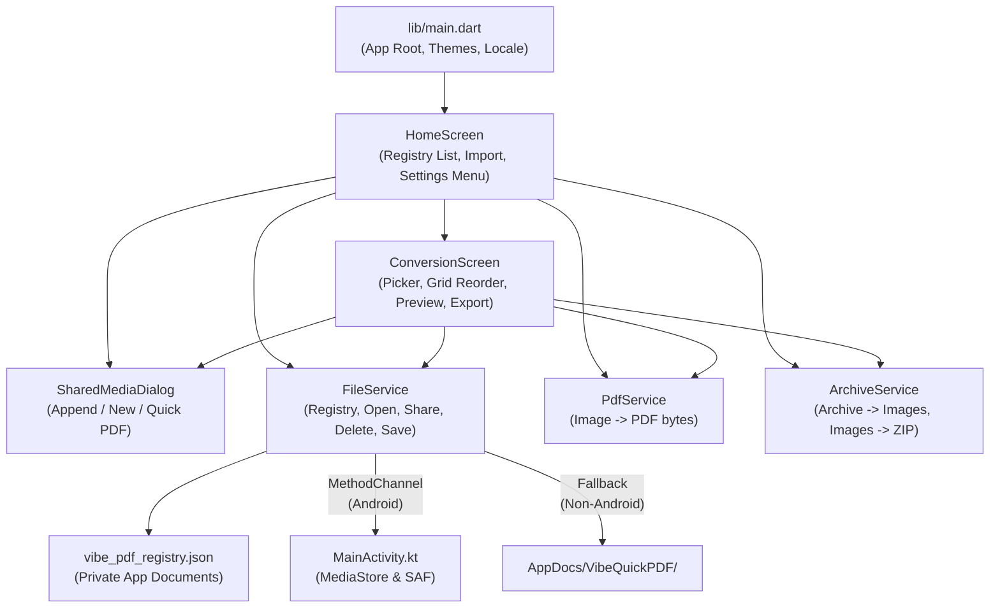
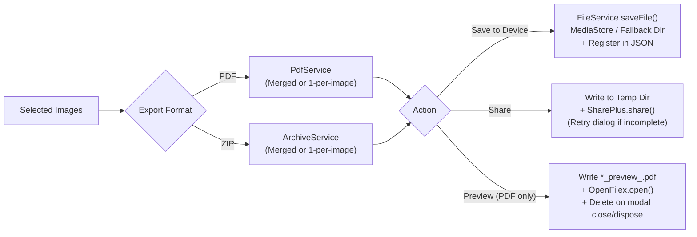
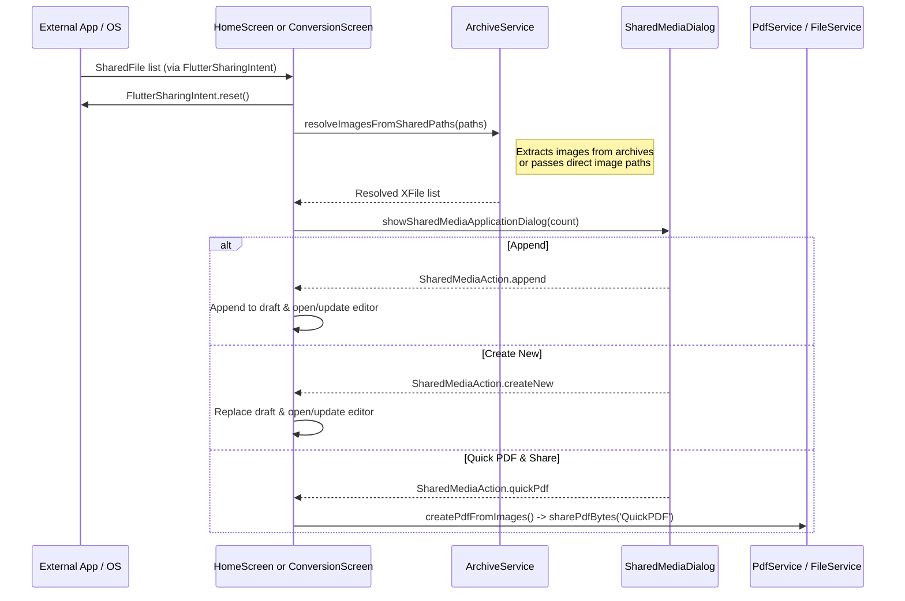

# Architecture

This document describes the high-level architecture, module responsibilities, and key data flows of **VibeQuickPDF** (`v1.3.2`).

---

## 1. High-Level Overview

VibeQuickPDF is a lightweight Flutter application structured around a clear separation between UI screens, stateless/focused service classes, a simple metadata model, and an Android native storage bridge.

---

## 2. Layer & Module Breakdown

### Entry Point & Global Runtime State
- **`lib/main.dart`**
  - Bootstraps `VibeQuickPdfApp` with Material 3 Light and Dark themes seeded from `Colors.redAccent` (dark scaffold `#141218`, dark cards `#211F26`).
  - Uses two lightweight global `ValueNotifier`s merged via `ListenableBuilder` so theme and locale changes rebuild `MaterialApp` immediately without external state-management packages:
    - `appThemeModeNotifier` (`ValueNotifier<ThemeMode>`, default `ThemeMode.system`)
    - `appLocaleNotifier` (`ValueNotifier<Locale?>`, defined in `lib/l10n/app_localizations.dart`, default `null` for system locale)

### Localization
- **`lib/l10n/app_localizations.dart`**
  - Custom `AppLocalizations` + `AppLocalizationsDelegate` supporting Thai (`th`) and English (`en`), falling back to Thai (`const Locale('th')`) when no supported locale matches.
  - All UI labels, dialog messages, snackbar strings, and default filenames (`เอกสาร` / `Document`) live here.

### Data Model
- **`lib/models/pdf_file.dart`**
  - Immutable `PdfFile` value object representing either a generated file (PDF or ZIP) or an imported PDF:
    - `name` (`String`)
    - `path` (`String` — either an Android `content://` URI or a filesystem path)
    - `createdAt` (`DateTime`, serialized as epoch milliseconds)
    - `size` (`int` in bytes)
    - `isImported` (`bool`, default `false`)
  - Provides `copyWith`, `toJson`, and `fromJson` (tolerant of both epoch-int and ISO-8601 string timestamps).

### UI Screens & Widgets
- **`lib/screens/home_screen.dart`**
  - Loads files from `FileService.getPdfFiles()` and displays app version via `PackageInfo.fromPlatform()`.
  - Listens to `FlutterSharingIntent` (`getMediaStream()` for warm starts, `getInitialSharing()` for cold starts). Guards with `_isConversionScreenOpen` so incoming intents while `ConversionScreen` is on top are handled exclusively by `ConversionScreen`.
  - Handles **Quick PDF & Share** directly from Home when triggered via the shared media bottom sheet.
  - Provides distinct delete confirmations for generated vs. imported files.
- **`lib/screens/conversion_screen.dart`**
  - Holds the working image list `_selectedImages` and syncs static `ConversionScreen.currentDraftImages` when shared media modifies the draft so *Append to current list* works across screen transitions.
  - Supports image input via `image_picker` (camera + multi-image gallery) and incoming share intents.
  - Implements 3-column grid reordering via `LongPressDraggable<int>` + `DragTarget<int>` (including dropping onto the trailing *Add Photo* tile to move to last) as well as a tap-to-reorder bottom sheet.
  - Manages the temporary preview file lifecycle (`_tempPreviewFile`, `_previewPdf()`, `_showPreviewModal()`, `_cleanupTempPreviewFile()`).
- **`lib/widgets/shared_media_dialog.dart`**
  - Renders `showSharedMediaApplicationDialog()` returning `SharedMediaAction` (`append`, `createNew`, `quickPdf`, or `null` on cancel).
- **`lib/widgets/theme_toggle_button.dart`**
  - Standalone animated theme toggle `IconButton` (retained as a reusable widget; `HomeScreen` currently exposes theme switching inside its overflow `PopupMenuButton`).

### Services
- **`lib/services/pdf_service.dart`**
  - Uses the `pdf` package (`pw.Document`, `pw.MemoryImage`).
  - Each page uses `PdfPageFormat(image.width!.toDouble(), image.height!.toDouble())` with `pw.EdgeInsets.zero`, preserving each photo's exact aspect ratio and eliminating margins.
- **`lib/services/archive_service.dart`**
  - **Extraction (`extractImagesFromArchive`, `resolveImagesFromSharedPaths`)**:
    - Supports `.zip`, `.tar`, `.tar.gz`, `.tgz`, `.gz` (with fallback `.zip`/`.tar` decode attempts for unknown extensions).
    - Filters to known image extensions (`.jpg`, `.jpeg`, `.png`, `.webp`, `.bmp`, `.gif`, `.heic`, `.heif`, `.tif`, `.tiff`), excluding `__MACOSX` entries and hidden files starting with `.`.
    - Sorts entries alphabetically by archive path before writing extracted files to `<tempDir>/extracted_archives/<timestamp>/`.
  - **ZIP Creation (`createZipFromImages`, `createZipFromImage`)**:
    - Encodes images with `ZipEncoder`.
    - Naming: `<baseName><ext>` for a single image, or `<baseName>_<paddedIndex><ext>` for multiple images (padding width: 1 for <10, 2 for 10–99, 3 for ≥100).
- **`lib/services/file_service.dart`**
  - Manages the private file registry (`<appDocs>/vibe_pdf_registry.json`), file persistence, Android native bridge calls, temporary preview/share files, viewing (`open_filex` or Android `ACTION_VIEW`), and sharing (`share_plus`).
  - Accepts an optional `isAndroid` constructor override (`FileService({bool? isAndroid})`) to make platform-specific logic cleanly unit-testable.

---

## 3. Key Data Flows

### Private Registry & Legacy Migration
Instead of scanning public folders (which can pick up unrelated files or fail under Android Scoped Storage), VibeQuickPDF keeps an explicit JSON index at `<appDocumentsDir>/vibe_pdf_registry.json`:

1. **First Launch Migration**: If `vibe_pdf_registry.json` does not exist yet, `_readRegistry()` checks for the legacy private folder `<appDocumentsDir>/VibePDFs/` (used prior to `v1.3.2`), imports any `.pdf`/`.zip` files found there as `isImported: false`, and writes the new registry file.
2. **Validation & Sync (`getPdfFiles()`)**: On every load/refresh:
   - For Android `content://` URIs: calls `inspectUri` on the native channel. Entries that can no longer be opened are pruned; updated names/sizes are written back.
   - For regular filesystem paths: checks `File.exists()` and `File.stat()`. Missing files are pruned; updated sizes are synced.
   - Returns entries sorted by `createdAt` descending (newest first).

### Export & Share Pipeline

### Incoming Shared Media Pipeline

